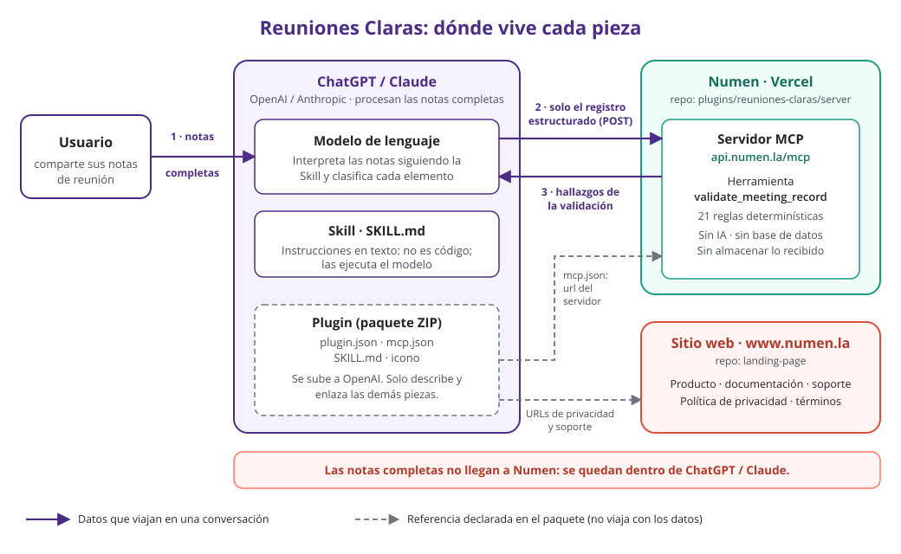
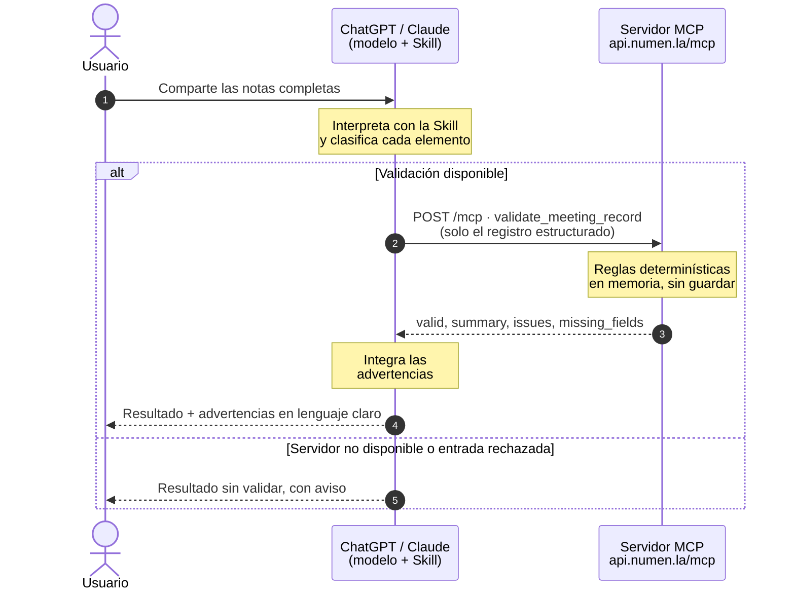

# Arquitectura de Reuniones Claras

## En una frase

El **plugin** es un paquete que describe y enlaza las demás piezas. La **Skill** es un texto de instrucciones que ejecuta el modelo de ChatGPT o Claude. El **servidor MCP** es un programa independiente, alojado en Vercel, con una única herramienta de validación. Son piezas distintas y viven en sitios distintos.

## Qué es cada pieza y dónde vive

| Pieza | Qué es | Dónde vive | Quién la ejecuta |
|---|---|---|---|
| **Plugin** | Paquete de archivos: `plugin.json` (nombre, descripción y URLs públicas), `SKILL.md`, `mcp.json` (la dirección del servidor) e icono | Código en `plugin/`; una vez enviado, en el directorio de OpenAI | Nadie: describe y empaqueta lo demás |
| **Skill** | Instrucciones en texto sobre cómo interpretar notas de reunión | Dentro del plugin (`plugin/skills/reuniones-claras/SKILL.md`) | **El modelo** (ChatGPT o Claude): las lee y las sigue |
| **Servidor MCP** | Programa web con una herramienta, `validate_meeting_record` | Vercel, en `https://api.numen.la/mcp` (código en `server/`) | Vercel, cuando alguien lo llama |
| **Páginas web** | Producto, documentación, soporte, política de privacidad y términos | `https://www.numen.la` (repositorio `landing-page`) | Vercel |

### El plugin no vive en el servidor

El plugin solo contiene una **referencia** al servidor: la línea `"url": "https://api.numen.la/mcp"` de `mcp.json`. El servidor **no sabe que existe un plugin**: es un endpoint MCP genérico y cualquier cliente MCP puede llamarlo. Se comprobó llamándolo desde un conector personalizado de Claude, sin ningún plugin de OpenAI de por medio.

Del mismo modo, el servidor no contiene la Skill ni la lógica de interpretación. Esa lógica está en el texto de `SKILL.md` y la ejecuta el modelo.

## Reparto de responsabilidades

| Componente | Responsabilidad | No hace |
|---|---|---|
| **Skill** (`plugin/skills/reuniones-claras/SKILL.md`) | Interpreta las notas; identifica decisiones, compromisos, responsables y fechas; distingue decisiones de propuestas; genera el registro estructurado; invoca la herramienta; integra las advertencias en la respuesta. | No delega la interpretación. |
| **Servidor MCP** (`server/`) | Recibe solo datos estructurados; aplica reglas determinísticas; devuelve hallazgos y campos incompletos. | No interpreta de nuevo la reunión, no modifica datos, no almacena nada, no llama a servicios externos. |
| **Usuario** | Comparte las notas con ChatGPT o Claude y recibe el resultado de la Skill, complementado por la validación. | |

La Skill se conserva con su metodología completa. Los cambios en `SKILL.md` son **aditivos**: un paso nuevo en el flujo, una sección sobre cómo usar la herramienta y dos líneas en el control de calidad final.

## Cómo viaja una conversación

1. El usuario comparte sus notas **completas** con ChatGPT o Claude. Ahí las procesan OpenAI o Anthropic, según sus propias políticas.
2. El modelo, siguiendo la Skill, interpreta las notas y arma un **registro estructurado**: descripciones breves, responsables, fechas, estados y citas de hasta 200 caracteres.
3. El modelo llama a la herramienta y envía **solo ese registro**, nunca las notas completas.
4. El servidor aplica sus reglas en memoria y devuelve los hallazgos.
5. El modelo integra las advertencias en su respuesta, en lenguaje normal y sin inventar datos.

Si el servidor no está disponible o rechaza la entrada, la Skill continúa sin validar y lo indica con un aviso.

## Para qué sirve el servidor MCP (y para qué no)

**Sirve para lo que un modelo de lenguaje no garantiza:**

- Comprobar de forma exacta que una fecha existe (`2026-02-30` no).
- Detectar duplicados y clasificaciones contradictorias, siempre con el mismo resultado.
- Rechazar números de tarjeta de pago antes de procesarlos.
- Dar el mismo veredicto cada vez ante la misma entrada.

**No sirve para:**

- Interpretar las notas: eso lo hace el modelo con la Skill.
- Confirmar que un acuerdo realmente ocurrió: solo revisa la coherencia del registro.
- Guardar nada: procesa en memoria y descarta.

**Razón práctica.** OpenAI ya no acepta para publicación plugins que solo contienen una Skill. Un plugin nuevo debe incluir un servidor MCP remoto, y ese es el motivo por el que existe este componente.

**Límite del valor.** La validación es una segunda revisión de lo que el propio modelo ya produjo. Es útil, pero modesta, y la revisión de OpenAI podría considerarla marginal: el servidor no garantiza la aprobación.

## Dentro del servidor, por capas

Cada solicitud atraviesa estas capas, en este orden. Todo ocurre en memoria y no se escribe nada.

1. `app/mcp/route.ts`: recibe `POST /mcp`. `GET`, `DELETE` y `OPTIONS` devuelven 405.
2. `lib/mcp/http.ts`: valida método, `Origin`, `Content-Type` y límite de tamaño (256 KB). Un fallo interno devuelve un error genérico sin datos.
3. `mcp-handler`: habla el protocolo MCP (Streamable HTTP, sin estado).
4. `lib/mcp/server.ts`: registra la herramienta con sus anotaciones de solo lectura.
5. `lib/mcp/schema.ts`: valida la estructura y los límites de la entrada (Zod 4).
6. `lib/mcp/restricted.ts`: rechaza entradas que parezcan un número de tarjeta de pago.
7. `lib/mcp/validate.ts`: aplica las reglas determinísticas y arma la respuesta, con los mensajes de `lib/mcp/codes.ts`.

## Estructura del código (`server/`)

| Archivo | Contenido |
|---|---|
| `app/mcp/route.ts` | Ruta `POST /mcp` (`nodejs`, dinámica, `maxDuration = 10`). `GET`, `DELETE` y `OPTIONS` devuelven 405. |
| `lib/mcp/http.ts` | Capa HTTP: método, `Origin`, `Content-Type`, límite de tamaño y errores genéricos. |
| `lib/mcp/server.ts` | Registro de la herramienta y opciones del manejador MCP (sin logs detallados, sin telemetría, sin flujos largos). |
| `lib/mcp/schema.ts` | Esquema de entrada y salida (Zod 4). |
| `lib/mcp/validate.ts` | Motor de reglas: función pura. |
| `lib/mcp/codes.ts` | Catálogo de códigos, severidades y mensajes en español e inglés. |
| `lib/mcp/dates.ts`, `normalize.ts`, `restricted.ts` | Clasificación de fechas, normalización de texto y barrera de números de tarjeta. |
| `lib/mcp/limits.ts` | Límites de entrada. |
| `tests/` | 138 pruebas automatizadas (Vitest). |
| `scripts/e2e.mjs` | Prueba de extremo a extremo con el cliente MCP oficial, contra un servidor local. |
| `scripts/smoke.mjs` | Verificación remota contra una URL desplegada (`MCP_URL=https://<host>/mcp npm run smoke`). |

## Decisiones técnicas

- **Next.js 16.4.6 (App Router).** La última 15.x (15.5.29) arrastra una versión de `postcss` con avisos de seguridad en `npm audit`; la 16.4.6 deja el árbol de producción con 0 vulnerabilidades. Se elige por ese motivo y no por ser la más reciente.
- **`mcp-handler` 2.4.0 + `@modelcontextprotocol/server` 2.4.0 + Zod 4.6.7.** Es la combinación que documenta Vercel para desplegar MCP en Next.js App Router (la guía pinea `mcp-handler@2.1.1`; se usa la 2.4.0, que declara el mismo par). `mcp-handler` 1.x exige una versión exacta del SDK antiguo.
- **Vitest 5.1.0.** Las series 3.x y 4.x traen `tinypool` con avisos críticos en `npm audit`. Exige Node ≥ 22.12, por eso `engines.node` es `22.x`.
- **Ruta `/mcp` directa**, sin reescrituras de host: este proyecto está pensado para servir `api.numen.la`.
- **Sin estado.** No hay sesiones, ni suscripciones (`maxSubscriptions: 0`), ni almacenamiento. Cada solicitud crea y descarta su propio contexto.
- **Sin registros de aplicación.** El código no usa `console.*`; `verboseLogs` está desactivado; no se usa `onEvent` y `telemetry: false`. Una prueba estática y otras dinámicas lo vigilan.
- **Sin dependencias de red ni de IA.** No se importa ningún cliente HTTP ni SDK de IA o analítica.

## Estado

| Elemento | Estado |
|---|---|
| Servidor MCP y herramienta | Implementado y **desplegado** en Vercel |
| Pruebas | 138 automatizadas, extremo a extremo con el cliente oficial y verificación remota 10/10 en `api.numen.la` |
| Paquete del plugin (manifiesto, `mcp.json`, Skill) | Implementado (ZIP v0.2.0) |
| Dominio `api.numen.la` | Configurado, solo DNS (sin proxy de Cloudflare) |
| Límite de frecuencia | Configurado en el Firewall de Vercel; el umbral exacto no está verificado |
| Privacidad y términos en la web | Publicados en producción; **pendiente de revisión legal** |
| Prueba de la Skill con el conjunto de evaluación | Pendiente |
| Envío a OpenAI (verificación de organización y de dominio, revisión) | **Pendiente de publicación** |
